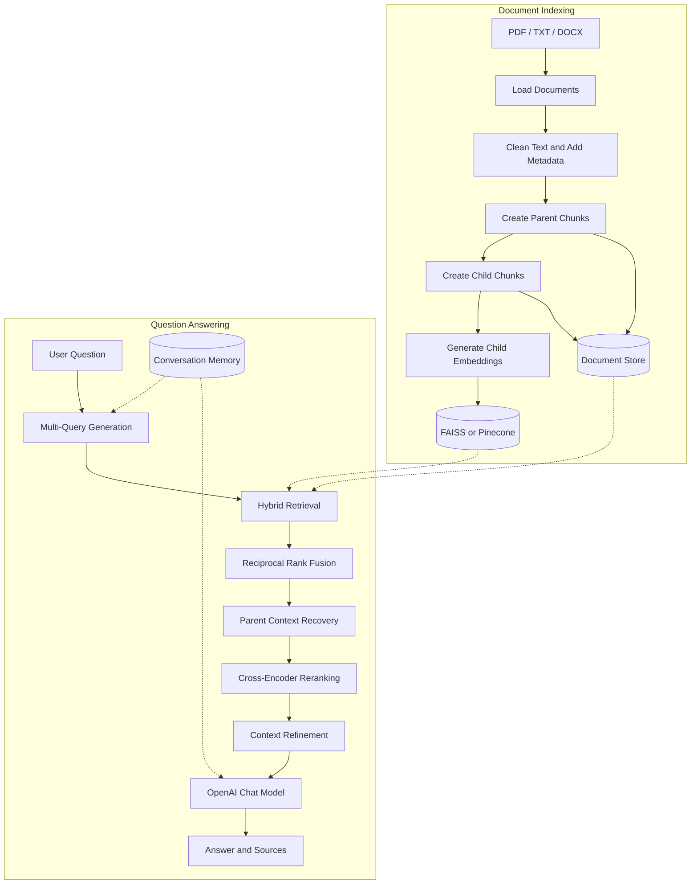

# Advanced RAG — Context-Aware Document Intelligence

**A modular Retrieval-Augmented Generation (RAG) application built with LangChain, OpenAI, FAISS, BM25, cross-encoder reranking, and Streamlit.**

Advanced RAG is a document question-answering application designed to improve how large language models retrieve, understand, and answer questions from private knowledge bases.

Instead of relying on a single vector search, this project combines **multi-query retrieval, hybrid search, Reciprocal Rank Fusion (RRF), parent-child retrieval, cross-encoder reranking, context refinement, and conversational memory** to build a more reliable question-answering pipeline.

The application comes with a synthetic knowledge base for a fictional company, TechNova Solutions. Users can query company policies and product documentation, inspect retrieval results at every stage, and upload their own PDF, TXT, or DOCX files.

---


## Project Overview

Traditional document chatbots often rely on a simple workflow: split documents into chunks, retrieve similar chunks using embeddings, and pass the results to an LLM.

Although this works for straightforward questions, retrieval quality can deteriorate when users use different terminology, ask follow-up questions, refer to exact identifiers, or require information spread across a larger passage.

This project explores a more robust approach by combining multiple retrieval and context-processing techniques in a modular RAG pipeline.

### Example knowledge base

The application includes four synthetic documents:

| Document | Format | Content |
|---|---|---|
| `technova_employee_handbook.pdf` | PDF | Leave policies, remote work, expenses, performance reviews |
| `technova_product_guide.pdf` | PDF | NovaCloud product information, pricing, usage limits |
| `technova_support_policy.txt` | TXT | Support plans, response times, refund policies |
| `technova_security_policy.docx` | DOCX | Password requirements, MFA, encryption, compliance |

Users can ask questions such as:

- How many days of annual leave do employees receive?
- What is TechNova's refund policy?
- Does that refund policy apply to enterprise customers?
- What is the minimum password length?
- What encryption standards are used to protect customer data?
- Which support plan offers the fastest response time?

The application also supports uploading additional PDF, TXT, and DOCX documents through the Streamlit sidebar.

**Note:** The included TechNova documents are synthetic examples intended for demonstration and testing, not real company policies.

---

## Why Advanced RAG?

### The limitations of basic RAG

A basic RAG pipeline typically follows three steps:

1. Split source documents into chunks and convert them into embeddings.
2. Retrieve the chunks most similar to the user's question.
3. Pass the retrieved text to an LLM to generate an answer.

This approach is simple, but several problems can occur:

- **Vocabulary mismatch:** The user asks about "time off", while the document uses "annual leave".
- **Exact-match retrieval:** An identifier such as `SOC 2` or `TN-SUP-2024` may not be retrieved reliably by semantic search alone.
- **Incomplete context:** A small chunk contains the matching sentence but omits the surrounding explanation or exceptions.
- **Ranking errors:** The nearest vector matches are not necessarily the most useful passages for answering the question.
- **Irrelevant context:** Unrelated chunks consume the context window and may influence the generated answer.
- **Conversational ambiguity:** A follow-up such as "Does that apply to enterprise customers?" needs information from the preceding conversation.

### The solution

This project addresses these challenges through a sequence of retrieval and context-processing stages.

| Challenge | Technique |
|---|---|
| Different ways of phrasing a question | Multi-query retrieval |
| Semantic and exact-keyword matching | Hybrid retrieval |
| Combining different ranked lists | Reciprocal Rank Fusion |
| Precise retrieval with sufficient surrounding context | Parent-child retrieval |
| Improving candidate relevance | Cross-encoder reranking |
| Removing low-quality context and controlling prompt size | Context refinement |
| Resolving conversational follow-ups | Conversation memory |
| Understanding and debugging retrieval failures | Retrieval debug mode |

The objective is not to add complexity for its own sake. Each component addresses a specific failure mode in the document question-answering process.

---

## Key Features

### Retrieval and context processing

- Multi-query generation using an LLM
- Hybrid retrieval using vector similarity and BM25
- Reciprocal Rank Fusion for merging ranked results
- Parent-child document chunking
- Parent-context recovery after child retrieval
- Cross-encoder reranking with a keyword-based fallback
- Configurable relevance filtering and context budgets
- Source-labelled context and answer citations

### Application and usability

- Interactive Streamlit chat interface
- PDF, TXT, and DOCX document ingestion
- Document uploads through the sidebar
- Build, update, and clear-index controls
- Session-based conversational memory
- Optional retrieval debugging panel
- Configurable FAISS and Pinecone backends

### Engineering and testing

- Modular codebase with separate pipeline components
- Centralized configuration through environment variables
- Cached LLM and embedding clients
- Command-line scripts for index management and evaluation
- Offline unit tests that do not require API calls
- Full and minimal dependency configurations

---

## System Architecture

The application has two main workflows: document indexing and question answering.



### Indexing workflow

Documents are loaded, cleaned, enriched with metadata, and divided into parent and child chunks. Child chunks are embedded and indexed for vector search, while the document store preserves the information required for keyword retrieval and parent-context recovery.

The resulting index can be reused across application sessions, avoiding unnecessary re-embedding of unchanged documents.

### Query workflow

When a question arrives, the application generates alternative query formulations, retrieves candidates through vector and keyword search, merges the rankings, recovers parent contexts, reranks candidates, and refines the final context before generating an answer.

The optional debug panel exposes intermediate results so retrieval failures can be investigated rather than treated as unexplained LLM errors.

---

## How the RAG Pipeline Works

The main orchestration function is `answer_question()` in `src/rag_pipeline.py`.

The pipeline follows these stages:

1. Generate alternative queries.
2. Retrieve and fuse candidate documents.
3. Recover parent contexts.
4. Rerank candidate passages.
5. Refine and budget the final context.
6. Generate the answer with source references.

Each stage is implemented in a separate module, making the system easier to understand, test, and extend.

---

## Technical Deep Dive

### 1. Hybrid Retrieval

**Module:** `src/retrieval.py`

#### Problem

Vector search identifies passages with similar semantic meaning, but it can be less reliable for exact identifiers, product codes, policy names, and other specific terms.

Keyword search has the opposite trade-off: it is effective when words overlap but can miss passages that express the same idea using different terminology.

#### Approach

The application combines two retrieval methods:

- **Vector retrieval:** Searches embeddings stored in FAISS or Pinecone.
- **BM25 retrieval:** Uses lexical matching through `rank_bm25`.

The results are then merged using Reciprocal Rank Fusion.

#### Reciprocal Rank Fusion

RRF combines ranked lists without requiring their raw scores to be directly comparable.

For a document \(d\), the fused score is:

\[
\operatorname{RRF}(d)=
\sum_{r \in R}
\frac{1}{k+\operatorname{rank}_{r}(d)}
\]

Where:

- \(R\) is the set of ranked retrieval results.
- \(\operatorname{rank}_{r}(d)\) is the document's position in a result list.
- \(k\) is a smoothing constant, configured as 60 in this implementation.

A passage that ranks highly across multiple retrieval lists receives a stronger combined score.

**Why it matters:** Combining semantic and lexical retrieval can improve candidate coverage, particularly for questions containing exact terminology.

---

### 2. Multi-Query Retrieval

**Module:** `src/retrieval.py`

#### Problem

A single question represents only one way of expressing the user's information need. Relevant documents may use different terminology or sentence structures.

#### Approach

The LLM generates alternative phrasings of the original question. The application searches using these variations and combines the resulting candidates.

For example:

```text
Original:
What is the refund policy?

Alternative queries:
How do refunds work at TechNova?
What are the conditions for receiving a refund?
Can a customer get their money back after cancellation?
```

The query-generation prompt also uses recent conversation history to clarify follow-up questions.

For example:

```text
Question 1: What is TechNova's refund policy?
Question 2: Does that policy apply to enterprise customers?
```

The second question can be rewritten into a standalone query about whether TechNova's refund policy covers enterprise customers.

**Why it matters:** Multi-query retrieval helps address vocabulary mismatch and makes follow-up questions easier to retrieve against the knowledge base.

---

### 3. Parent-Child Retrieval

**Modules:** `src/chunking.py`, `src/retrieval.py`

#### Problem

Chunk size introduces a trade-off.

- Small chunks can produce precise matches but may omit important context.
- Large chunks preserve more context but may produce less precise embeddings.

#### Approach

The application uses two levels of document chunks:

| Chunk type | Approximate size | Purpose |
|---|---:|---|
| Parent | 1,600 characters | Preserve surrounding context |
| Child | 400 characters | Enable more targeted retrieval |

The process works as follows:

1. Split the source documents into parent chunks.
2. Divide each parent into smaller child chunks.
3. Generate embeddings for the child chunks.
4. Retrieve matching children.
5. Use each child's `parent_id` to recover the associated parent context.
6. Deduplicate repeated parents before passing the context to later stages.

Example:

```text
Retrieved child:
"Refunds are issued to the original payment method."

Recovered parent:
"REFUND POLICY
Customers on monthly self-service plans may request a full
refund within 30 days. Enterprise contracts are not covered..."
```

The retrieved child helps identify the relevant passage, while the parent preserves surrounding conditions and exceptions.

**Why it matters:** Parent-child retrieval balances retrieval precision with the contextual information needed for answer generation.

---

### 4. Cross-Encoder Reranking

**Module:** `src/reranking.py`

#### Problem

Initial retrieval needs to be fast enough to search a large collection of chunks. Embedding similarity is useful for candidate generation, but it does not always identify which candidate best answers a particular question.

#### Approach

The application uses a two-stage retrieval strategy:

```text
Initial retrieval
       ↓
Candidate passages
       ↓
Cross-encoder relevance scoring
       ↓
Best-ranked passages
```

The configured model is:

`cross-encoder/ms-marco-MiniLM-L-6-v2`

Unlike a bi-encoder retrieval step, which compares separately generated representations, a cross-encoder processes the query and candidate passage together to estimate their relevance.

The model runs locally and can be downloaded automatically on first use.

If the cross-encoder cannot be loaded, the application can fall back to a simpler keyword-based reranker.

#### Why use two stages?

Searching the entire knowledge base with a cross-encoder would be expensive. Instead, the application first retrieves a manageable set of candidates and then applies more detailed relevance scoring to those candidates.

The debug panel displays reranking scores, helping developers investigate which passages are promoted or demoted.

**Important:** Cross-encoder scores are model-specific relevance scores, not calibrated probabilities. Their values and thresholds should be interpreted in the context of the configured model.

---

### 5. Context Refinement

**Module:** `src/refinement.py`

#### Problem

Even after retrieval and reranking, some candidates may be irrelevant or redundant. Passing every candidate to the LLM can increase prompt size, latency, and the chance that irrelevant material influences the answer.

#### Approach

The refinement stage applies three operations:

1. **Relevance filtering:** Discard candidates below the configured `MIN_RERANK_SCORE` threshold.
2. **Context budgeting:** Add candidates in ranked order until the `MAX_CONTEXT_CHARS` limit is reached.
3. **Source formatting:** Label surviving passages so the answer-generation prompt can refer to them using source numbers.

The documented defaults are:

| Setting | Default | Purpose |
|---|---:|---|
| `MIN_RERANK_SCORE` | `-4.0` | Minimum score for retaining a passage |
| `MAX_CONTEXT_CHARS` | `8000` | Approximate maximum context characters |

The actual values can be changed through the application's configuration.

The context budget is a character-based limit, not a precise tokenizer-based token limit. The resulting token count therefore varies with the content.

#### Why it matters

Context refinement creates a deliberate boundary between retrieving potentially useful information and deciding what the LLM should actually see.

It also makes debugging more transparent: developers can compare retrieved candidates with the final context and identify where relevant evidence is lost.

---

### 6. Source Attribution

**Modules:** `src/refinement.py`, `src/rag_pipeline.py`

Retrieved passages are formatted with source labels before being passed to the answer-generation prompt.

This allows the application to associate an answer with the documents and sections that supplied its supporting information.

For example:

```text
[1] technova_security_policy.docx - Section: Password Policy
[2] technova_security_policy.docx - Section: Data Encryption
```

Source attribution improves traceability and helps users inspect the evidence behind an answer.

It is important to distinguish source attribution from guaranteed factual correctness: a citation is useful only when the cited passage actually supports the claim.

---

## Technology Stack

| Technology | Role |
|---|---|
| Python | Core application and pipeline logic |
| Streamlit | Interactive web interface |
| LangChain | Document loading, text processing, and LLM integration |
| OpenAI chat models | Query generation and answer generation |
| OpenAI embeddings | Document and query vector representations |
| FAISS | Local vector similarity search |
| Pinecone | Optional hosted vector database |
| BM25 / `rank_bm25` | Keyword-based retrieval |
| Reciprocal Rank Fusion | Combining ranked retrieval results |
| Sentence Transformers | Local cross-encoder reranking |
| PyTorch | Runtime dependency for the cross-encoder |
| `python-dotenv` | Environment-variable configuration |
| pytest | Automated testing |

---

## Project Structure

```text
advanced-rag-project/
│
├── app.py                    # Streamlit interface and chat workflow
├── config.py                 # Centralized application settings
├── llm_client.py             # Cached OpenAI chat and embedding clients
├── conftest.py               # Pytest import configuration
├── requirements.txt          # Full dependency set
├── requirements-minimal.txt  # Installation without PyTorch
├── .env.example              # Environment configuration template
├── .gitignore
│
├── data/
│   ├── documents/             # Sample documents and uploaded files
│   └── evaluation/
│       └── questions.json     # Synthetic evaluation questions
│
├── vectorstore/               # Generated index; excluded from Git
│   ├── faiss/                 # Local FAISS index files
│   └── doc_store.json         # Parent and child document storage
│
├── src/
│   ├── ingestion.py            # Loading, cleaning, and metadata
│   ├── chunking.py             # Parent-child chunk creation
│   ├── indexing.py             # Build, update, and clear index
│   ├── retrieval.py            # Multi-query, hybrid search, RRF
│   ├── reranking.py            # Cross-encoder and fallback reranking
│   ├── refinement.py           # Filtering, context budget, citations
│   ├── memory.py               # Session conversation history
│   └── rag_pipeline.py         # End-to-end RAG orchestration
│
├── scripts/
│   ├── build_index.py          # Build the index from the CLI
│   ├── update_index.py         # Update an existing index
│   ├── evaluate.py             # Run the evaluation dataset
│   └── generate_sample_documents.py
│
└── tests/
    └── test_pipeline.py        # Offline pipeline tests
```

**Recommended starting point:** Read `src/rag_pipeline.py` and locate `answer_question()`. It provides the high-level sequence of the pipeline and shows how the individual modules fit together.

---

## Getting Started

### Prerequisites

- Python 3.10 or newer
- An OpenAI API key with API access and available credit
- Git
- Internet access for OpenAI API requests and initial model downloads

A GPU is not required.

### 1. Clone the repository

Replace the placeholder with your actual GitHub repository URL.

```bash
git clone <YOUR_REPOSITORY_URL>
cd advanced-rag-project
```

### 2. Create a virtual environment

```bash
python -m venv .venv
```

Activate it using the appropriate command.

**Windows — PowerShell**

```powershell
.venv\Scripts\Activate.ps1
```

**Windows — Command Prompt**

```cmd
.venv\Scripts\activate.bat
```

**macOS / Linux**

```bash
source .venv/bin/activate
```

### 3. Install dependencies

For the full installation, including the cross-encoder reranker:

```bash
python -m pip install --upgrade pip
pip install -r requirements.txt
```

If PyTorch causes installation or runtime issues, see [CPU-Only Execution and Minimal Installation](#cpu-only-execution-and-minimal-installation).

### 4. Configure the environment

Create your local `.env` file from the template.

**Windows — PowerShell**

```powershell
Copy-Item .env.example .env
```

**macOS / Linux**

```bash
cp .env.example .env
```

Open `.env` and add your OpenAI API key.

```dotenv
OPENAI_API_KEY=your_openai_api_key
```

Do not commit this file to GitHub.

### 5. Build the index and start the app

```bash
python scripts/build_index.py
streamlit run app.py
```

Alternatively, you can start the app first and use the **Build Vector DB** control in the sidebar.

Open the local address displayed by Streamlit, typically:

`http://localhost:8501`

---

## Environment Configuration

The application reads its settings from `.env` through `config.py`.

### Core settings

| Variable | Default / requirement | Purpose |
|---|---|---|
| `OPENAI_API_KEY` | Required | Authenticates OpenAI API requests |
| `OPENAI_CHAT_MODEL` | `gpt-4o-mini` | Generates query variations and answers |
| `OPENAI_EMBEDDING_MODEL` | `text-embedding-3-small` | Creates vector embeddings |
| `VECTOR_DB` | FAISS | Selects the vector database backend |
| `RERANKER` | See `config.py` | Selects the reranking strategy |
| `MIN_RERANK_SCORE` | `-4.0` | Filters low-scoring passages |
| `MAX_CONTEXT_CHARS` | `8000` | Controls the final context budget |

The exact set of supported variables and defaults is defined by `config.py` and `.env.example`.

### Model initialization and caching

The chat and embedding clients are initialized in `llm_client.py` and cached using `@lru_cache`.

This avoids unnecessarily recreating the same client objects during repeated calls.

**Important:** If you change `OPENAI_EMBEDDING_MODEL`, rebuild the vector index. Embeddings produced by different models may have different dimensions or vector spaces and should not be mixed in the same index.

### API costs

The chat and embedding models run through the OpenAI API, so requests can incur charges according to your account's model pricing.

Indexing requires embedding the source documents. Subsequent questions can reuse the saved index, but query generation, answer generation, and any other configured API calls may incur additional costs.

Actual costs depend on the selected models, document sizes, and number of requests.

---

## Vector Database Configuration

### FAISS — Default local backend

FAISS is used as the default vector search backend because it can run locally without a hosted vector database account.

When the index is built:

1. Child chunks are sent to the embedding model.
2. The generated vectors are saved in the FAISS index.
3. Parent and child document information is persisted in `doc_store.json`.
4. The saved artifacts are reused when the application starts again.

Typical generated files include:

```text
vectorstore/
├── faiss/
│   ├── index.faiss
│   └── index.pkl
└── doc_store.json
```

The exact files depend on the configured backend and implementation.

**Privacy consideration:** FAISS is local, but document content sent to OpenAI for embeddings or answer generation is processed by the external API. Do not assume that using a local vector database makes the entire pipeline local.

### Pinecone — Optional hosted backend

Pinecone can be used when you want vector storage in a hosted database rather than on your machine.

To configure it:

1. Create a Pinecone account.
2. Create an index with dimensions matching your embedding model.
3. Configure the Pinecone environment variables.
4. Set the vector database backend to Pinecone.
5. Rebuild the index.

Example configuration:

```dotenv
VECTOR_DB=pinecone
PINECONE_API_KEY=your_pinecone_api_key
PINECONE_INDEX_NAME=advanced-rag
PINECONE_NAMESPACE=default
```

For the documented OpenAI embedding models, the expected dimensions are:

- `text-embedding-3-small`: 1,536 dimensions by default.
- `text-embedding-3-large`: 3,072 dimensions by default.

Ensure that the Pinecone index matches the actual dimensions configured for your embeddings.

The document store remains local in this design, supporting parent lookup and BM25 retrieval.

---

## Running the Application

Start the Streamlit interface:

```bash
streamlit run app.py
```

On the first run:

1. Open the sidebar.
2. Select **Build Vector DB** to index the sample documents.
3. Ask a question using the chat interface.
4. Enable **Show Retrieval Details** to inspect the retrieval pipeline.

After the initial indexing step, the saved index can be reused until documents, embedding settings, or chunking settings require a rebuild.

---

## Building and Updating the Index

### Build a new index

Use the Streamlit sidebar or run:

```bash
python scripts/build_index.py
```

The indexing workflow is:

```text
Source Documents
      ↓
Document Loading and Cleaning
      ↓
Parent Chunk Creation
      ↓
Child Chunk Creation
      ↓
Child Embeddings
      ↓
Vector Index + Document Store
```

A full build is appropriate when creating the initial index, changing the embedding model, changing chunking parameters, or rebuilding after modifying existing source files.

### Update an existing index

When adding new documents, an incremental update can avoid embedding all previously indexed content again.

**Through the UI:**

1. Upload PDF, TXT, or DOCX files through the sidebar.
2. Save the uploaded files into the documents directory.
3. Select **Update Vector DB**.

**Through the command line:**

```bash
python scripts/update_index.py
```

The update process is designed to identify already-indexed content using document-derived identifiers.

One limitation to be aware of: if the identifier is based only on the filename, editing a document without changing its name may not trigger a re-index. Rebuild the index after modifying existing files unless change detection is implemented.

### Clear and rebuild

Use the application's clear/rebuild control to remove the existing index and create a fresh one.

Only remove generated index artifacts, not the source documents you want to retain.

---

## Retrieval Debug Mode

One of the most useful development features is the retrieval inspection panel.

Enable **Show Retrieval Details** in the sidebar, submit a question, and expand the retrieval details shown with the response.

The panel exposes the intermediate stages of the pipeline.

| Stage | What it shows |
|---|---|
| Original query | The question submitted by the user |
| Generated queries | Alternative query formulations |
| Retrieved candidates | Candidate passages returned by hybrid search and fusion |
| After reranking | Reordered candidates with relevance scores |
| Final context | Passages retained after filtering and budgeting |
| Sources | Source references associated with the answer |

### How to use it for debugging

**Case 1: The relevant passage never appears in retrieved candidates.**

Investigate document ingestion, chunking, query generation, vector search, BM25 retrieval, and retrieval limits.

**Case 2: The relevant passage appears in the candidates but ranks poorly.**

Investigate reranker behavior, the query wording, and the quality of the retrieved parent context.

**Case 3: The relevant passage appears after reranking but disappears from the final context.**

Investigate `MIN_RERANK_SCORE`, the context budget, and the selection logic in `src/refinement.py`.

**Case 4: The relevant evidence reaches the LLM, but the answer is incorrect.**

Investigate prompt instructions, conflicting evidence, source attribution, conversation history, and answer-generation behavior.

This separation is important because a wrong answer does not necessarily mean the LLM itself is the root cause. The problem may originate much earlier in the retrieval pipeline.

---

## Conversational Memory

**Module:** `src/memory.py`

The application uses LangChain's `InMemoryChatMessageHistory` to maintain conversation history within a Streamlit session.

Memory is used in two places:

1. **Query rewriting:** Recent messages help resolve follow-up questions into standalone search queries.
2. **Answer generation:** Relevant conversation history helps the LLM produce coherent conversational responses.

Example interaction:

```text
User: What is TechNova's refund policy?

Assistant: [Explains the refund policy with sources.]

User: Does that policy apply to enterprise customers?

Assistant: [Uses the previous question to interpret the follow-up.]
```

The history is limited by the configured `MEMORY_WINDOW`, which defaults to four exchanges according to the project configuration.

Because this is in-memory session history, it is not a persistent database. It should not be treated as durable memory across sessions or application restarts.

---

## Evaluation

**Dataset:** `data/evaluation/questions.json`

The project includes 20 synthetic questions about the TechNova knowledge base. Each question specifies the expected source document and keywords that a correct answer should contain.

Run the full evaluation:

```bash
python scripts/evaluate.py
```

Run a smaller evaluation:

```bash
python scripts/evaluate.py --limit 5
```

### What is evaluated?

The script checks two aspects of the output:

- **Source retrieval:** Whether the expected source document was cited.
- **Answer keyword coverage:** Whether the generated answer contains at least one expected keyword.

The combined result identifies cases where both checks pass.

### Interpreting the results

The evaluation script may produce output in the following format:

```text
SUMMARY
  Correct source cited  : <count>/<total>
  Expected keyword found: <count>/<total>
  Both correct          : <count>/<total>
```

Run the evaluation on your current code and use the resulting metrics when documenting actual performance.

For example, if your latest run produces 19 correct source citations out of 20 questions, the source citation rate is 95%.

The keyword evaluation is a lightweight regression check, not a complete measure of answer quality. It does not establish that an answer is fully correct, sufficiently supported, or free from hallucinations.

Evaluation results are written to:

```text
data/evaluation/results.json
```

The results file is generated by the evaluation script and may be excluded from version control or committed intentionally, depending on your repository policy.

### Future evaluation improvements

Potential next steps include:

- Retrieval Precision@K and Recall@K
- Mean Reciprocal Rank (MRR)
- Normalized Discounted Cumulative Gain (NDCG)
- Faithfulness and answer relevance evaluation
- Context relevance evaluation
- LLM-as-judge evaluation with a documented rubric
- Regression tests for known retrieval failures

These additions would provide a more comprehensive view of the relationship between retrieval quality and final answer quality.

---

## Testing

Run the automated test suite from the project root:

```bash
pytest
```

The project includes 22 offline tests covering areas such as:

- Document cleaning and metadata
- Parent-child chunking
- Reciprocal Rank Fusion
- Parent-context recovery
- Context refinement
- Citation formatting

These tests are designed to run without calling the OpenAI API, helping keep routine regression testing fast and inexpensive.

Run the tests after modifying retrieval logic, chunking parameters, reranking behavior, or context-refinement rules.

---

## CPU-Only Execution and Minimal Installation

A GPU is not required for the application.

The OpenAI chat and embedding models run remotely. The cross-encoder reranker is the primary machine-learning model that runs locally.

### Full installation

The full dependency set includes PyTorch and the cross-encoder model.

```bash
pip install -r requirements.txt
```

The first use of the cross-encoder may require downloading its model files.

### Minimal installation

For environments where PyTorch cannot be installed or loaded reliably:

```bash
pip install -r requirements-minimal.txt
```

Then configure:

```dotenv
RERANKER=simple
```

Restart the application after changing the environment.

The minimal configuration uses keyword-based reranking instead of the cross-encoder. The rest of the application can retain its document ingestion, chunking, indexing, retrieval, context refinement, citations, conversation memory, and Streamlit interface.

The trade-off is relevance quality: keyword overlap is less capable of recognizing semantic relationships than a trained cross-encoder.

If the full installation fails, check the error message and your Python environment before switching configurations. On supported systems, a CPU-only PyTorch installation may also be sufficient.

---

## Troubleshooting

### `OPENAI_API_KEY` is not set

Ensure that `.env` exists in the project root and contains a valid API key. Restart Streamlit after updating environment settings.

### No FAISS index found

Build the index through the UI or run:

```bash
python scripts/build_index.py
```

### PyTorch or DLL errors on Windows

Errors such as `WinError 1114` or failures involving `c10.dll` can indicate a PyTorch installation or native-library problem.

Try the minimal dependency configuration with `RERANKER=simple`, or investigate the Python environment and PyTorch installation.

### The sidebar reports a simple keyword reranker

This indicates that the fallback reranker is active, usually because the cross-encoder could not be loaded.

Check the accompanying warning for the underlying error. The application can continue running, but ranking quality may differ.

### The first question takes a long time

The cross-encoder may be downloading its model files on first use. Later requests can reuse the locally cached model.

API latency, query generation, and answer generation can also contribute to response time.

### OpenAI rate-limit or quota errors

Check your API usage, billing status, model access, and rate limits. A valid API key does not necessarily mean the account has available API credit.

### The answer says information is missing

Enable retrieval debug mode.

- If the relevant passage is absent from the initial candidates, investigate retrieval and indexing.
- If it disappears after reranking or refinement, inspect the corresponding scores, thresholds, and context budget.
- If it remains in the final context, investigate answer generation and source attribution.

### `ModuleNotFoundError: No module named 'src'`

Run commands from the project root, not from inside `src/` or `scripts/`.

### Results become unreliable after changing the embedding model

Rebuild the index using the new embedding model so that the stored vectors and query vectors are compatible.

### Updating an edited document has no effect

If duplicate prevention is based on filenames, modifying a file without changing its name may not trigger re-indexing. Perform a full rebuild or implement content-hash-based change detection.

### A scanned PDF returns no useful text

The current ingestion workflow depends on text that can be extracted from supported documents. Image-only scanned PDFs may require OCR, which is outside the current documented scope.

---

## Current Limitations

The project is designed as an educational and engineering-oriented RAG application, and it has several limitations:

- The included company documents are synthetic.
- Chat and embedding generation depend on an external OpenAI API.
- FAISS storage is local, while Pinecone is an optional hosted alternative.
- Conversation history is session-based rather than persistent.
- Keyword-based evaluation cannot fully assess answer correctness or hallucination.
- The minimal reranker is less semantically capable than the cross-encoder.
- Image-only scanned PDFs require OCR support.
- Retrieval quality depends on document quality, chunking, ranking, filtering, and prompt construction.
- Source citations provide traceability but do not independently guarantee that every generated claim is supported.

These limitations also identify practical areas for further engineering work.

---

## Future Improvements

Potential extensions include:

- **Stronger evaluation:** Add retrieval metrics, faithfulness evaluation, and answer-relevance scoring.
- **Improved document change detection:** Use content hashes or document versions for reliable incremental indexing.
- **Persistent conversation storage:** Introduce a database-backed chat history when cross-session continuity is required.
- **OCR support:** Extract text from scanned PDFs and image-based documents.
- **Better context selection:** Investigate redundancy reduction, token-aware budgeting, and more advanced contextual compression.
- **Observability:** Add structured logs, retrieval latency measurements, API usage tracking, and failure diagnostics.
- **Security hardening:** Validate uploaded files, limit file sizes, and review handling of sensitive document content.
- **Deployment:** Package the application for a reproducible deployment environment.
- **Expanded test coverage:** Add integration tests and regression cases for known retrieval and answer-generation failures.

These are possible extensions rather than claims about existing functionality.

---

## Learning Outcomes

This project demonstrates practical work with several important concepts in modern LLM application development:

- Designing a modular RAG architecture
- Building document ingestion and preprocessing pipelines
- Understanding embeddings and vector similarity search
- Combining semantic and lexical retrieval
- Implementing Reciprocal Rank Fusion
- Applying parent-child chunking and context recovery
- Using cross-encoders for relevance reranking
- Managing context quality and prompt budgets
- Handling conversational follow-up questions
- Debugging intermediate retrieval stages
- Building lightweight automated evaluations
- Testing pipeline components independently
- Managing local vector indexes and optional hosted storage

The main engineering lesson is that **reliable RAG depends on the entire pipeline, not just the LLM**. Retrieval coverage, ranking quality, context selection, prompt construction, and evaluation all influence the final response.

---

## License

Add the license that applies to your repository and its dependencies. Do not claim an open-source license unless you have selected and included one.

---

**Built as a practical exploration of advanced Retrieval-Augmented Generation, retrieval debugging, and reliable document question answering.**
